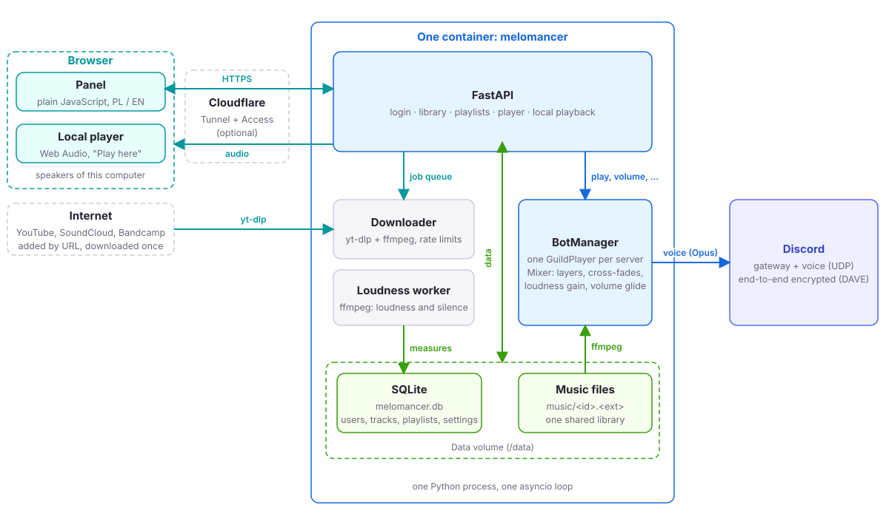
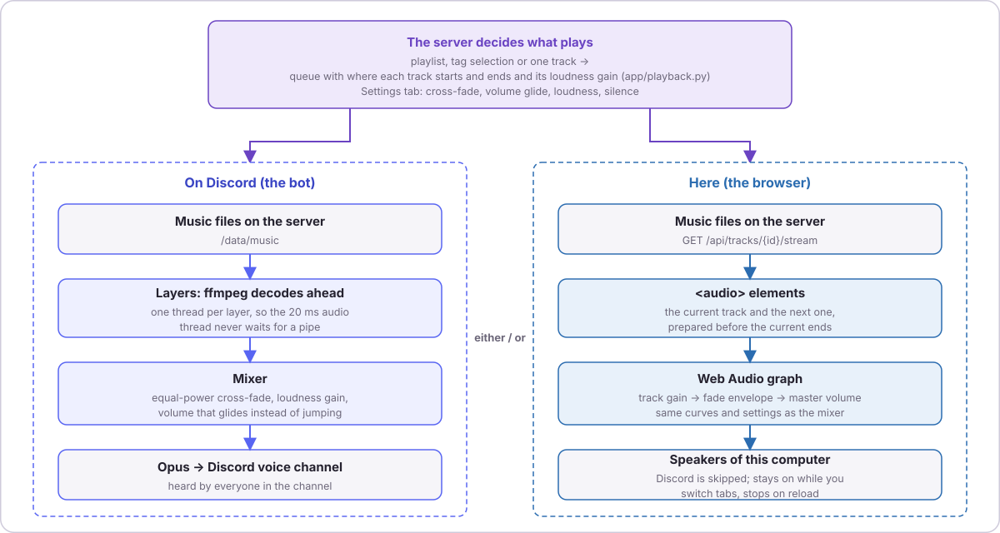

# Architecture

Languages: **English** · [Polski](../pl/architecture.md)

## Overview

<picture>
  <source media="(prefers-color-scheme: dark)" srcset="../img/overview-en-dark.svg">
  
</picture>

One Python process, one container:

```
 browser ──HTTP──► FastAPI (app/main.py) ──► SQLite  /data/melomancer.db
                     │   ├─ routes_auth       login, users, system
                     │   ├─ routes_library    upload, tags, tracks, downloads
                     │   ├─ routes_playlists  sets, folders, playlists
                     │   └─ routes_player     connect, play, volume
                     │
                     ├─► BotManager (app/player.py) ──► discord.py ──► Discord gateway + voice (UDP)
                     │        └─ one GuildPlayer per server ──► ffmpeg ──► Opus
                     │
                     └─► Downloader thread (app/downloader.py) ──► yt-dlp + ffmpeg ──► library
 files: /data/music/<track id>.<ext>
```

The Discord client runs on the same asyncio loop as the web server. Database access is plain `sqlite3` with a short transaction per request. Playback decodes with `ffmpeg` and sends Opus to Discord through `discord.py` (with `davey` for the end-to-end encrypted voice protocol DAVE).

The browser side is a static page (`app/static`): plain JavaScript, no build step, Polish and English dictionaries in `i18n.js`.

## Modules

| File | Role |
|---|---|
| `app/main.py` | Application factory, security headers, first-run administrator, lifespan (starts and stops the bot and the downloader) |
| `app/config.py` | Settings from environment variables |
| `app/db.py` | Schema migrations (`PRAGMA user_version`) and the transaction helper |
| `app/security.py` | Argon2 hashing, session tokens, login throttle |
| `app/deps.py` | Authentication, administrator check, CSRF header check |
| `app/library.py` | Probing with ffprobe, de-duplication by SHA-256, tags, tombstones, track listing |
| `app/downloader.py` | URL validation, daily limit, queue worker around yt-dlp |
| `app/player.py` | `GuildPlayer` (queue, volume, reconnect cool-down) and `BotManager` |
| `app/loudness.py` | Background analysis (loudness and silence in one ffmpeg pass), the playback gain, `RuntimeSettings` (everything the administrator changes in the panel) |
| `app/updates.py` | The look at the newest GitHub release for the Settings tab: version parsing and comparison, a cache with ETag, a background thread (see Update notice) |
| `app/sysload.py` | Container CPU and memory from the cgroup (v2 or v1), sampled every 2 s, the last ten minutes kept (three minutes of them go to the charts), for the Settings tab |
| `app/mixer.py` | PCM mixer: layers decoded ahead by threads, equal-power cross-fades, the next track queued before the current one ends |
| `app/playback.py` | The rule for where a track starts and ends (hand-set points, silence trimming, a seek) and the entry the browser player gets for a track. One function for the bot and for the browser |
| `app/routes_local.py` | `/api/local/queue` and `/api/local/resolve`: what plays in the browser |
| `app/static/local.js` | `LocalPlayer`, the browser's own player (Web Audio) |
| `app/routes_*.py` | HTTP API |
| `app/cli.py` | `reset-password` recovery command |

## Data model

```
users ──< sessions
  │  └──< guild_access (user, guild id)
  │
  ├──< tracks (owner)  ──< track_tags (shared tags)
  │        │         └──< user_tags (user, track, personal tag)
  │        └──────────────┐
  └──< sets ──< playlists ──< playlist_items ─┘
         └──< set_groups (folder, optional) ──< playlists
downloads (user, url, status, track)
user_prefs (user, key, value: the server and channel last chosen in the player)
```

- **tracks** are never physically deleted. Deleting sets `deleted_at` and removes the file, so `playlist_items` keep pointing at a row with the old title (the greyed-out entry). A partial unique index keeps `sha256` unique among live tracks only, so re-uploading identical content revives the old row (same id).
- Sets, folders and playlists cascade on delete. Tracks are never touched by that.
- Positions are integers, rewritten when an order is saved.
- `tracks.trim_start` and `tracks.trim_end` are the start and end set by hand (seconds of the file, NULL = automatic; `PATCH /tracks/{id}` with an explicit null clears one). `GuildPlayer._span` lets each of them win over the silence analysis on its own side, whether or not the administrator's switch is on, and refuses to leave less than a second of sound.
- `tracks.silence_lead`, `tracks.silence_trail` and `tracks.silence_db` hold the silence at the start and end of a track in seconds and the threshold it was measured with (the same ffmpeg pass uses `silencedetect` before `loudnorm`). A track whose `silence_db` differs from the current threshold is measured again. When trimming is on, `GuildPlayer._span` starts the layer at `lead` (`-ss`) and ends it at `duration - trail`: that point becomes the layer's `duration`, so the cross-fade and the preroll are timed from it, and `Layer.stop_at` ends the layer there when there is no cross-fade. The player clock stays in file time.
- `tracks.loudness` (integrated LUFS) and `tracks.peak` (true peak, dBTP) are filled in by a background thread (`app/loudness.py`) that picks the newest unmeasured track, measures it with ffmpeg `loudnorm` (analysis only, run under `nice`) and sets `loudness_tried`. NULL means unknown: the track plays unchanged. At playback `BotManager.gain_for` turns the measurement into a gain (target minus loudness, limited by the maximum boost and by keeping the peak under -1 dBTP) that multiplies the volume of the `PCMVolumeTransformer`; nothing is re-encoded. The switch, the target level and the maximum boost are set by an administrator in the panel and live in the `app_settings` table (`RuntimeSettings` in `app/loudness.py`); there are no environment variables for them.
- `playlists.kind` is `manual` (rows in `playlist_items`) or `tags` (a JSON rule in `playlists.rule`: `{"tags": [...], "mode": "all"|"any"}`). A tag playlist stores no items, its tracks are computed with `library.tracks_for_tags` when it is shown or played, from shared tags and the owner's personal tags. `POST /player/{guild}/play` can also take `tags` and `mode` directly to play an unsaved selection.

## Permissions

| Resource | Read | Write |
|---|---|---|
| Library listing, preview | any user | n/a |
| Track title, shared tags, deletion | any user | owner, administrator |
| Personal tags | author only | author |
| Sets, folders, playlists | owner, administrator | owner, administrator |
| Download jobs | owner, administrator | owner, administrator |
| Users, server access | administrator | administrator |
| Player of a Discord server | users granted that server, administrators | same, one controller at a time |

## Playback

<picture>
  <source media="(prefers-color-scheme: dark)" srcset="../img/playback-en-dark.svg">
  
</picture>

- One `GuildPlayer` per Discord server holds the queue (track ids, titles, paths), the order (shuffled or not), loop and shuffle flags, volume and the controlling user.
- Each track is played through `FFmpegPCMAudio` wrapped in `PCMVolumeTransformer`. Changing the volume sets the transformer's volume, so it applies within a frame (20 ms).
- **Mixing and cross-fades.** The voice client plays one `MixerSource` for the whole playlist, not one source per track. `app/mixer.py` keeps up to three *layers* (each a `discord.FFmpegPCMAudio` read ahead by its own thread, so the 20 ms audio thread never waits on a pipe), fades them against each other with equal-power curves (sin in, cos out, applied four times per frame) and hands out the sum. When the current layer has `crossfade + 2.5 s` left, the mixer reports a *preroll*; the player then plans the next track (`GuildPlayer._plan_next`, which wraps and reshuffles when the playlist loops) and queues it with `set_next`. The queued layer starts fading in when the current one has `crossfade` seconds left, and the player is told with a *transition* event so `pos` follows the audio. A manual next, previous, jump, seek or a new playlist uses `switch_to` instead: the new layer fades in as soon as it has decoded its first frame, and the old ones fade out. Seeking is such a switch to the same track at another offset, with the short seek fade. The volume and each layer's loudness gain are not applied as steps: every 20 ms frame the applied value moves a fraction of the way towards the wanted one (time constant 250 ms by default, a setting), interpolated inside the frame like a fade, so a change never makes a click. A mix that runs dry (last track, unknown length, a failing track) ends the voice-client source and `after` makes the player start a new one, which is also the fallback when the cross-fade is 0. In that case the older ffmpeg filter `afade` applies the per-playlist fade; with the cross-fade on it is skipped, because both together would dip twice.
- **Generation counter.** Every started or stopped source bumps a counter. The `after` callback of a source that was replaced or stopped sees an old number and does nothing, which makes skip, stop and replace race-free.
- **Failures.** A track that ends within 1.5 s or errors counts as a failure. If every track of a queue fails in a row, playback stops instead of looping forever. Missing files are skipped.
- **Reconnects.** If the voice session ends unexpectedly, the player resets and refuses new connections for 35 seconds. `discord.py` keeps a timer for the old session for about 30 seconds, and joining again inside that window can get every new session killed. The same lesson is built into the `discord-stream-bot` project.
- **Idle leave.** A background task checks every 30 seconds; a channel without any human for `IDLE_LEAVE_MINUTES` is left.
- Discord ids are always strings in the API (JavaScript cannot hold 64-bit integers).

## Playing in the browser

The same panel can play on the computer it is open on instead of on Discord. The division of work: the server decides, the page plays.

- `POST /api/local/queue` takes the same target as the bot's `play` (a playlist, a track or a tag selection; `routes_player.resolve_target` serves both, so permissions and the rows are the same) and returns the tracks in playing order with, for each, the part of the file to play (`start`, `end`) and the loudness `gain`, worked out by `app/playback.py` with the same rules the bot applies, plus the playlist's loop, shuffle and volume. Nothing is touched on the bot, no Discord connection is needed and the controller lock does not apply.
- `LocalPlayer` (`app/static/local.js`) is one object for the whole page, outside every view, which is why switching tabs of the panel does not interrupt the sound. Each track is an `<audio>` element fed from `/api/tracks/{id}/stream` into a Web Audio graph: track gain (loudness) → envelope (fades) → master (volume) → speakers. Cross-fades use the same equal-power curves as the mixer (`setValueCurveAtTime`), the volume glides with `setTargetAtTime` (time constant = the glide setting divided by 3), a seek is a short fade to a second element at the new position, and the next track is prepared when `crossfade + 2.5 s` are left, as on the bot. The queue logic (order, shuffle, loop wrap, skip, jump, option changes) follows `GuildPlayer`. **The two implementations must be kept in step**: when a fade, the volume rule or the queue behaviour changes in one, change it in the other.
- `/api/system` carries `settings_rev`, a counter of the administrator's changes. The page asks every 10 seconds while playing; when the number moved it calls `POST /api/local/resolve` with the queued track ids and applies the new points and gains to what is playing (the gain glides) and plans the next track again. Cross-fade, seek-fade and glide times are read from `/api/system` too.
- `snapshot()` has the shape of the bot's state, so the player screen paints both with the same code. Another tab of the panel starting local playback silences this one (`BroadcastChannel`). The page cannot start sound without a click (autoplay policy), and reloading it ends it.

## Downloads

1. `POST /api/downloads` validates the address (https, allowed host), checks the daily limit and inserts a `queued` row.
2. The worker thread picks the oldest queued job, runs yt-dlp (audio only, one video, size limit) into a temporary folder, extracts Opus with ffmpeg and hands the file to the same ingest function as uploads (probe, hash, de-duplicate, store).
3. The row becomes `done` or `error` with a short reason. After a job the worker pauses `YTDLP_MIN_GAP_SECONDS`.
4. Jobs interrupted by a restart go back to the queue.

## HTTP API

All paths are under `/api`; state-changing requests need the header `X-Melomancer: 1`; every path except `/auth/login` and `/health` needs a session cookie.

| Area | Endpoints |
|---|---|
| Auth | `POST /auth/login`, `POST /auth/local` (only with `AUTO_LOGIN`, from this computer: see Security), `POST /auth/logout`, `GET/PATCH /auth/me`, `POST /auth/password` |
| Users | `GET/POST /users`, `PATCH /users/{id}`, `PUT /users/{id}/guilds` |
| Library | `GET /tracks`, `POST /tracks/upload`, `PATCH/DELETE /tracks/{id}`, `GET /tracks/{id}/usage`, `GET /tracks/{id}/stream`, `PUT /tracks/{id}/my-tags`, `GET /tags` |
| Downloads | `GET/POST /downloads` (the list also carries live progress, elapsed seconds and the remaining pause; `POST` takes `tags` and `my_tags`), `DELETE /downloads/{id}` |
| Playlists | `GET/POST /sets`, `PATCH/DELETE /sets/{id}`, `POST /sets/{id}/playlists`, `PUT /sets/{id}/playlists/order`, `POST /sets/{id}/groups`, `PUT /sets/{id}/groups/order`, `PATCH/DELETE /groups/{id}`, `POST /groups/{id}/playlists`, `PUT /groups/{id}/playlists/order`, `GET/PATCH/DELETE /playlists/{id}`, `POST /playlists/{id}/copy` (one target: `user_id`, `set_id` or `group_id`), `POST /playlists/{id}/items`, `PUT /playlists/{id}/order`, `PUT/DELETE /playlists/{id}/items/{item}` |
| Player | `GET/PUT /player/choice` (the server and channel last chosen, kept per person), `GET /player/guilds`, `GET /player/{guild}/state`, `POST /player/{guild}/connect`, `disconnect`, `play`, `pause`, `resume`, `next`, `prev`, `jump`, `seek`, `stop`, `volume`, `PATCH /player/{guild}/options` |
| People | `GET /people` (active accounts other than yours, names only, for choosing who to copy to) |
| Local playback | `POST /local/queue` (the same body as `play`: `playlist_id`, `track_id` or `tags` + `mode`), `POST /local/resolve` (`track_ids`) |
| System | `GET /system`, `PATCH /system` (administrator: loudness, cross-fade and silence settings), `GET /system/load` (administrator: CPU and memory), `GET /system/update` and `POST /system/update/check` (administrator: newest release, asking now), `GET /health` |

## Update notice

`UpdateChecker` (`app/updates.py`) asks `https://api.github.com/repos/RadzuPL/melomancer/releases/latest` with one anonymous GET: 8 s timeout, the answer limited to 256 KB, an `If-None-Match` header with the last ETag so that an unchanged release costs a 304. The server asks, not the browser, because the panel's content security policy allows no outside requests. A daemon thread (started in the lifespan like the other workers) looks 30 s after the start and then every 6 hours, but only while the `update_check` setting is on; a rate limit from GitHub (403 or 429) pauses it for an hour. `POST /system/update/check` asks at once, at most once in 10 seconds, whatever the switch says. Nothing is persisted: after a restart the first check refills the cache.

The tag (`vX.Y.Z`) is parsed into three numbers and compared as numbers, so 0.6.10 is above 0.6.9. Drafts, pre-releases and odd tags are ignored. The link to the release notes is built from the tag, never taken from the answer. A running version that is not three numbers (`dev`) is never compared and the thread does not start. Failures are short codes (`unreachable`, `rate_limited`, `bad_response`) that the panel translates under `update_err_*`, and the last good answer is kept. The Monday rebuild creates a release like any other, so it counts as an update.

## Not built yet

Ambient layers under the music and a sound-effects board (the mixer is the place for both). The data model does not stand in the way of any of them.
