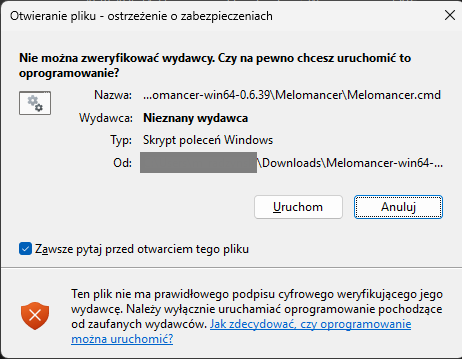

# Melomancer on Windows

Languages: **English** · [Polski](../pl/windows.md)

Melomancer is a music player for tabletop RPG sessions. You can play the music from your computer's speakers, or through a bot in a Discord voice channel. This guide shows how to start it on an ordinary Windows computer, **without installing anything**.

This is a test version. It works, but there is no installer or tray icon yet, and Windows will ask for your permission the first time you start it (step 3).

## Before you start

- A computer with Windows 10 or 11. You do not need an administrator account.
- About 140 MB to download and a few hundred MB of free disk space, plus room for your music.
- Internet access.
- For music on Discord: a bot of your own and a Discord account. Without a bot you can still play, from the computer's speakers (step 4).

## Step 1. Download

1. Open https://github.com/RadzuPL/melomancer/releases
2. The newest version is at the top. In its description there is a line **Windows package** with a link. Click it. (The same file is further down, in the **Assets** section.)
3. Your browser downloads a file named like `Melomancer-win64-0.6.39.zip` (about 140 MB), usually into the **Downloads** folder.

If the newest version has no such file, wait a few minutes or take the previous version from the list.

## Step 2. Unpack

1. Right-click the downloaded file and choose **Extract all…**
2. As the place, type the folder where the program should stay, for example `C:\Melomancer`, and click **Extract**.

Two notes: do not start the program from inside the zip (unpack it first), and do not unpack into **Program Files**, because Windows asks for administrator rights there. After unpacking you can delete the downloaded zip.

## Step 3. Start it

In the unpacked folder double-click the file **Melomancer.cmd** (it has a gears icon).

Windows shows this window (here from a Polish Windows; in an English one it is titled "Open File - Security Warning" and says "Unable to verify the publisher"):

This is normal. Windows shows it for every program that has no paid publisher certificate, and Melomancer has none. If you trust the program:

1. **Untick** the box **Always ask before opening this file**, so that Windows does not ask every time.
2. Click **Run**.

Instead, you may get a blue page "Windows protected your PC". Then click **More info**, then **Run anyway**.

A few seconds later your browser opens the Melomancer page. You do not have to sign in. Melomancer runs **in the background**, without a window of its own: next to the clock (the bottom right corner of the screen) a blue icon with a gear and a musical note appears and a short message says "Melomancer is running". If you do not see the icon, click the arrow **^** next to the clock, because Windows likes to hide new icons. A small black window may have flashed for a moment: that is normal.

If the browser does not open by itself, right-click the icon next to the clock and choose **Open Melomancer**. You can also type this address into the address bar: http://127.0.0.1:8080/ (bookmark it, it will be handy).

## Step 4. Add music and play

1. The **Library** tab: click **Choose files** (or **Choose folder**) and pick your tracks. You can also drag them with the mouse onto the dashed area.
2. Or the **Downloads** tab: paste the address of a YouTube video and click **Download**.
3. The **Playlists** tab: click **New set** (it is like a folder for a few playlists, for example one session), then **New playlist**, type a name, click **Create** and add tracks to it.
4. The **Player** tab: click **Play here**, then your playlist. The music plays from the computer's speakers.

More about the panel: [Using the panel](usage.md).

## Step 5 (optional). Music on Discord

To play music in a Discord voice channel you need a bot of your own: a robot account that you create for free on the Discord website. You will need two things:

- The **token**: a long secret string of characters, it works like a password for your bot.
- The **Application ID**: a long number that identifies your application.

1. Create the bot and copy those two things following the guide [Creating the Discord bot](discord-bot.md) (steps 1 to 4).
2. In the Melomancer panel open **Settings**. At the very top is the **Discord bot** card. (While the bot has no token, the **Player** page also shows a yellow bar with a **Connect the bot** button that leads to the same place.)
3. Paste the **token** and the **Application ID** into the two fields and click **Save and connect**. There is nothing to close or restart: after a few seconds the card says **The bot is running as** and the name of your bot, and shrinks to a single line. To change the token later, click **Change the token or the Application ID** in it.
4. Click **Add the bot to a server** (the button is next to **Save and connect**) and pick your Discord server (you need the permission to manage that server).
5. In the **Player** tab choose the **Server** and the **Voice channel**, click **Connect**, then your playlist.

The panel stores both values in the settings file on this computer, so they survive a restart. The panel never shows the token itself: the field only tells you that one is saved. If you paste the Application ID instead of the token, the panel recognises it and tells you what is missing. **Remove the token** switches the bot off.

**Keep the token secret**: do not send it to anyone and do not paste it in messages or screenshots. If it ever leaks, click **Reset Token** in the Developer Portal and paste the new one in Settings.

## Every day

- **Start:** double-click **Melomancer.cmd** and wait for the browser to open. If Melomancer is already running, a second start only opens its page.
- **The icon next to the clock** has a menu (right-click it): **Open Melomancer**, **Open the settings file**, **Show the log files**, **Start with Windows** (tick it if Melomancer should start by itself when you switch the computer on) and **Quit Melomancer**. When a newer version exists the menu also has **Update available: X** (a balloon appears once, too); clicking it opens the panel, where you install the update in Settings.
- Closing the browser tab does **not** switch Melomancer off. But music started with **Play here** plays only while that tab is open; the Discord bot does not need the tab.
- **To finish:** right-click the icon, **Quit Melomancer**.

## Updating

In the panel, in **Settings** in the group **Updates**, you will see "Update available" when there is a new version. To install it:

1. Click **Download and install**. Melomancer downloads the new package (a few hundred MB, a progress bar shows how far it is), checks it and unpacks it next to the program. Nothing changes yet, and the music goes on playing.
2. When **Install and restart** appears, click it and confirm. Melomancer switches off for a moment (the music stops), swaps its folder for the new one and starts by itself. The page refreshes by itself and Settings shows the new version number.

Your settings, library and token stay. If the new version does not start, the old one comes back by itself and a window tells you so. The installation needs about 1 GB of free space on the disk that holds the Melomancer folder, and permission to write in the folder that contains it (an ordinary user folder has both).

When this does not work (for example for lack of space or permission), update by hand:

1. Quit Melomancer (the icon next to the clock, **Quit Melomancer**).
2. Download the new package (step 1) and unpack it into a **new** folder, for example `C:\Melomancer-2` (step 2).
3. Start **Melomancer.cmd** from the new folder (Windows asks for permission again, because it is a new place, step 3).
4. When everything works, you can delete the old folder.

Your music, playlists and settings **stay**, because they live in a different place than the program.

## Removing

Quit Melomancer (the icon next to the clock, **Quit Melomancer**). If you used **Start with Windows**, untick it in the icon menu first. Then delete the program folder. That is all. To remove your library and settings too, delete the folder `C:\Users\YourName\AppData\Local\Melomancer` (to find it, press Win+R, type `%LOCALAPPDATA%` and press Enter). **Careful: that deletes the music you uploaded and the playlists**, so copy what you want to keep first.

## When something does not work

| What you see | What to do |
|---|---|
| Windows asks about the publisher every time | In that window untick **Always ask before opening this file** before you click **Run**. |
| Windows or the antivirus blocks the file or puts it in quarantine | The program has no digital signature, so it is sometimes blocked by mistake. Allow this folder in your antivirus or in Windows Security. |
| A window "Melomancer could not start" appears | Read what it says. Most often another program uses the same address, or there is a typing mistake in the settings file: fix it, or delete the file `config.toml` (the program makes a new one at the next start). |
| Nothing happens after the start and there is no icon next to the clock | Start **Diagnostyka - Diagnostics.cmd** from the Melomancer folder. It shows a black window with messages that say what is wrong. |
| The browser does not open | Right-click the icon next to the clock and choose **Open Melomancer**, or type the address http://127.0.0.1:8080/ yourself. |
| The page does not open and the window talks about an address in use | Another program uses the same "port". See the [details for advanced users](windows-advanced.md#problems). |
| The bot shows "Not running" or "Discord rejected the token" | The token is missing or wrong. Paste it again in **Settings**, **Discord bot**: it must be the token from the **Bot** tab (after **Reset Token**), not the Application ID or the Client Secret. |
| The Player has no servers | The bot is not on your server yet: in **Settings** use **Add the bot to a server**. |
| The bot is in the channel but there is no sound | Check that the bot may speak in that channel (the channel permissions in Discord). |
| Downloading from YouTube does not work | YouTube changes things often. Update Melomancer to the newest version. |

Something else? Report it at https://github.com/RadzuPL/melomancer/issues: say what you did, which version the icon menu next to the clock shows (the item above Quit), and include the last few lines of the log file (icon menu, **Show the log files**, the file `melomancer.log`). **Never include the token.**

## For advanced users

All the settings, signing in without a password, starting with Windows, the differences from the container version and how the package is built: [Windows: details for advanced users](windows-advanced.md).
