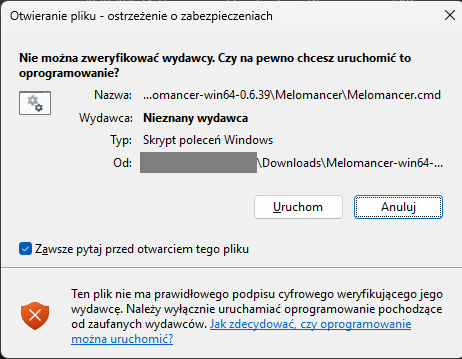

# Melomancer na Windows

Języki: [English](../en/windows.md) · **Polski**

Melomancer to odtwarzacz muzyki na sesje RPG. Muzykę możesz puszczać z głośników swojego komputera albo przez bota na kanale głosowym Discorda. Ta instrukcja pokazuje, jak uruchomić go na zwykłym komputerze z Windows, **bez instalowania czegokolwiek**.

To wersja testowa. Działa, ale nie ma jeszcze instalatora ani ikony przy zegarze, a Windows będzie pytał o zgodę przy pierwszym uruchomieniu (to opisuję w kroku 3).

## Zanim zaczniesz

- Komputer z Windows 10 lub 11. Nie potrzebujesz konta administratora.
- Około 140 MB do pobrania i kilkaset MB wolnego miejsca na dysku, plus miejsce na Twoją muzykę.
- Internet.
- Jeśli chcesz muzykę na Discordzie: własny bot i konto na Discordzie. Bez bota też zagrasz, z głośników komputera (krok 4).

## Krok 1. Pobierz program

1. Wejdź na stronę https://github.com/RadzuPL/melomancer/releases
2. Na samej górze jest najnowsza wersja. W jej opisie znajdziesz linię **Windows package** z odnośnikiem. Kliknij go. (Ten sam plik jest też niżej, w sekcji **Assets**.)
3. Przeglądarka pobierze plik o nazwie podobnej do `Melomancer-win64-0.6.39.zip` (około 140 MB). Zwykle ląduje w folderze **Pobrane**.

Jeśli w najnowszej wersji nie ma takiego pliku, poczekaj kilka minut albo weź poprzednią wersję z listy.

## Krok 2. Rozpakuj

1. Kliknij pobrany plik prawym przyciskiem myszy i wybierz **Wyodrębnij wszystko…**
2. Jako miejsce wpisz folder, w którym ma zostać program, na przykład `C:\Melomancer`, i kliknij **Wyodrębnij**.

Dwie ważne uwagi: nie uruchamiaj programu z wnętrza zipa (najpierw rozpakuj) i nie rozpakowuj do folderu **Program Files**, bo Windows wymaga tam uprawnień administratora. Po rozpakowaniu pobrany plik zip możesz skasować.

## Krok 3. Uruchom

W rozpakowanym folderze kliknij dwukrotnie plik **Melomancer.cmd** (ma ikonę z trybikami).

Windows pokaże takie okno:



To normalne. Windows pokazuje je przy każdym programie, który nie ma płatnego certyfikatu wydawcy, a Melomancer go nie ma. Jeśli ufasz programowi, zrób tak:

1. **Odznacz** kwadracik **Zawsze pytaj przed otwarciem tego pliku**, żeby Windows nie pytał za każdym razem.
2. Kliknij **Uruchom**.

Zamiast tego może pojawić się niebieska strona „System Windows ochronił ten komputer". Wtedy kliknij **Więcej informacji**, a potem **Uruchom mimo to**.

Po chwili otworzy się **czarne okno** z napisami. To właśnie działa Melomancer: **nie zamykaj go, dopóki słuchasz muzyki**. Po kilku sekundach otworzy się też przeglądarka ze stroną Melomancera. Nie musisz się logować.

Gdyby przeglądarka sama się nie otworzyła, wpisz w pasku adresu: http://127.0.0.1:8080/ (i dodaj tę stronę do zakładek, przyda się na co dzień).

## Krok 4. Dodaj muzykę i zagraj

1. Zakładka **Biblioteka**: kliknij **Wybierz pliki** (albo **Wybierz folder**) i wskaż swoje utwory. Możesz też przeciągnąć je myszką na przerywane pole.
2. Albo zakładka **Pobieranie**: wklej adres filmu z YouTube i kliknij **Pobierz**.
3. Zakładka **Playlisty**: kliknij **Nowy zestaw** (to jak teczka na kilka playlist, na przykład jedna sesja), potem **Nowa playlista**, wpisz nazwę, kliknij **Utwórz** i dodaj do niej utwory.
4. Zakładka **Odtwarzacz**: kliknij **Odtwarzaj tutaj**, a potem swoją playlistę. Muzyka zagra z głośników komputera.

Dokładniej o panelu: [Obsługa panelu](usage.md).

## Krok 5 (nieobowiązkowy). Muzyka na Discordzie

Żeby muzyka grała na kanale głosowym Discorda, potrzebujesz własnego bota, czyli konta-robota, które założysz za darmo na stronie Discorda. Potrzebne będą dwie rzeczy:

- **Token** to długi tajny ciąg znaków, działa jak hasło do Twojego bota.
- **Application ID** to długi numer Twojej aplikacji.

1. Załóż bota i skopiuj te dwie rzeczy według instrukcji: [Tworzenie bota Discord](discord-bot.md) (kroki 1 do 4).
2. W folderze Melomancera kliknij dwukrotnie **Ustawienia - Settings.cmd**. Otworzy się Notatnik z plikiem ustawień.
3. Znajdź dwie linie, które wyglądają tak (na początku mają znak `#`, który znaczy „ta linia jest tylko opisem, program ją pomija"):

   ```
   # discord_token = ''
   # discord_client_id = ''
   ```

4. Usuń `#` i spację za nim, a swoje wartości wklej **między apostrofy** (apostrofów nie usuwaj):

   ```
   discord_token = 'tutaj-wklej-token'
   discord_client_id = '123456789012345678'
   ```

5. Zapisz plik (Ctrl+S) i zamknij Notatnik.
6. Zamknij czarne okno Melomancera i uruchom **Melomancer.cmd** jeszcze raz. W oknie pojawi się napis, że bot się zalogował.
7. W panelu wejdź w **Ustawienia**. Zobaczysz, że bot **Działa**, i przycisk **Dodaj bota do serwera**. Kliknij go i wybierz swój serwer Discorda (potrzebujesz tam uprawnienia do zarządzania serwerem).
8. W zakładce **Odtwarzacz** wybierz **Serwer** i **Kanał głosowy**, kliknij **Połącz**, a potem swoją playlistę.

**Token trzymaj w tajemnicy**: nie wysyłaj go nikomu ani nie wklejaj w wiadomościach i zrzutach ekranu. Jeśli wycieknie, w Developer Portal kliknij **Reset Token** i wpisz nowy do pliku.

## Na co dzień

- **Start:** kliknij dwukrotnie **Melomancer.cmd** i poczekaj, aż otworzy się przeglądarka.
- **Czarne okno** możesz zminimalizować, ale nie zamykaj go. Zamknięcie okna wyłącza Melomancera i muzyka przestaje grać.
- **Koniec:** zamknij czarne okno.

## Aktualizacja

W panelu, w **Ustawieniach** w grupie **Aktualizacje**, zobaczysz napis „Dostępna aktualizacja", gdy jest nowa wersja. Żeby ją zainstalować:

1. Zamknij czarne okno.
2. Pobierz nową paczkę (krok 1) i rozpakuj ją do **nowego** folderu, na przykład `C:\Melomancer-2` (krok 2).
3. Uruchom **Melomancer.cmd** z nowego folderu (Windows znów zapyta o zgodę, bo to nowe miejsce, krok 3).
4. Gdy wszystko działa, stary folder możesz skasować.

Twoja muzyka, playlisty i ustawienia **zostają**, bo leżą w innym miejscu niż program.

## Usuwanie

Zamknij czarne okno i skasuj folder z programem. To wszystko. Jeśli chcesz usunąć też swoją bibliotekę i ustawienia, skasuj folder `C:\Users\TwojaNazwa\AppData\Local\Melomancer` (żeby go znaleźć, naciśnij Win+R, wpisz `%LOCALAPPDATA%` i naciśnij Enter). **Uwaga: to kasuje wgraną muzykę i playlisty**, więc najpierw skopiuj, co chcesz zachować.

## Kiedy coś nie działa

| Co widzisz | Co zrobić |
|---|---|
| Windows pyta o wydawcę za każdym razem | W tym oknie odznacz **Zawsze pytaj przed otwarciem tego pliku**, zanim klikniesz **Uruchom**. |
| Windows albo antywirus blokuje plik albo wrzuca go do kwarantanny | Program nie ma cyfrowego podpisu, więc zdarza się, że jest blokowany po omacku. Zezwól na ten folder w antywirusie albo w Zabezpieczeniach Windows. |
| Czarne okno pokazuje błąd i czeka | Przeczytaj, co pisze. Najczęściej to literówka w pliku ustawień: popraw ją albo skasuj plik `config.toml` (program zrobi nowy przy następnym starcie). |
| Przeglądarka się nie otwiera | Wpisz sam adres http://127.0.0.1:8080/ |
| Panel nie chce się otworzyć, a okno mówi o zajętym adresie | Inny program używa tego samego „portu". Zobacz [szczegóły dla zaawansowanych](windows-advanced.md#problemy). |
| Bot pokazuje „Nie działa" | Pewnie brakuje tokena w pliku ustawień albo jest błędny. Wklej go jeszcze raz (krok 5). |
| W Odtwarzaczu nie ma serwerów | Bot nie jest jeszcze na Twoim serwerze: w **Ustawieniach** użyj **Dodaj bota do serwera**. |
| Bot jest na kanale, ale nie słychać muzyki | Sprawdź, czy bot ma na tym kanale prawo mówić (uprawnienia kanału na Discordzie). |
| Pobieranie z YouTube nie działa | YouTube często coś zmienia. Zaktualizuj Melomancera do najnowszej wersji. |

Coś innego? Zgłoś to na https://github.com/RadzuPL/melomancer/issues: napisz, co robiłeś, jaką wersję pokazuje pierwsza linia czarnego okna, i dołącz kilka ostatnich linii tego okna. **Nigdy nie dołączaj tokena.**

## Dla zaawansowanych

Wszystkie ustawienia, logowanie bez hasła, uruchamianie razem z Windows, różnice względem wersji w kontenerze i budowa paczki: [Windows: szczegóły dla zaawansowanych](windows-advanced.md).
